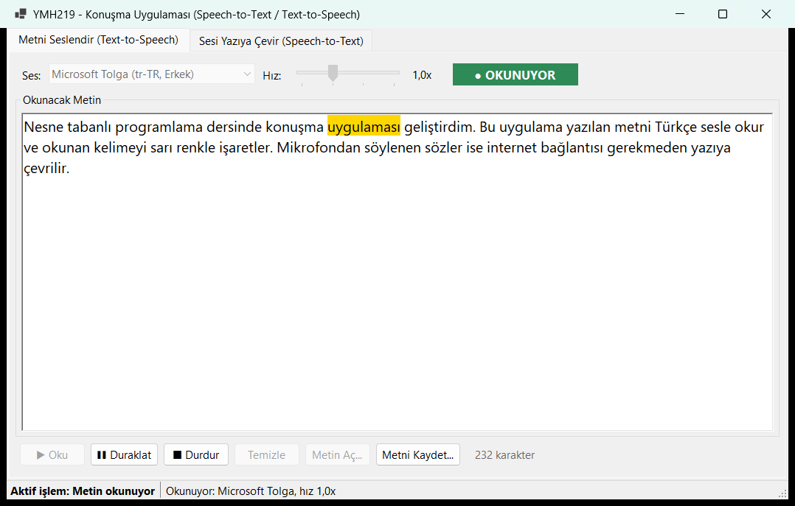
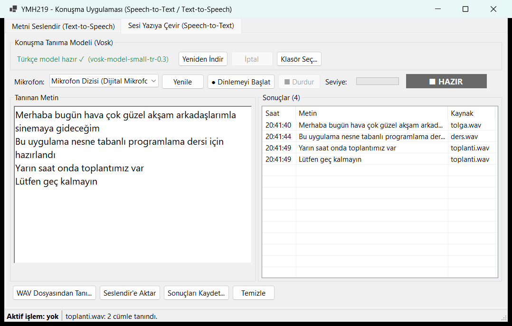

# YMH219 - Konuşma Uygulaması (Speech-to-Text / Text-to-Speech)

Nesne Tabanlı Programlama (YMH 219) dersi için C# ve Windows Forms ile geliştirilmiş, ses ile metin arasında çift yönlü dönüşüm yapan uygulama. Yazılan metin Türkçe sesle okunur (Text-to-Speech); mikrofondan söylenen veya bir WAV dosyasındaki konuşma internet bağlantısı gerekmeden yazıya çevrilir (Speech-to-Text).

## Özellikler

**Metni Seslendir (Text-to-Speech)**
- Metin kutusundaki yazıyı seçilen sesle okuma (Türkçe ses varsa otomatik seçilir)
- **Oku**, **Duraklat / Devam Et**, **Durdur** ve **Temizle** düğmeleri
- Okunan kelimenin metin içinde sarı renkle işaretlenmesi
- Ses seçimi ve konuşma hızı ayarı (0,5x - 2,0x)
- Metni `.txt` dosyasından açma ve `.txt` olarak kaydetme (UTF-8; eski ANSI/Windows-1254 Türkçe dosyalar da doğru okunur)

**Sesi Yazıya Çevir (Speech-to-Text)**
- Mikrofon listesi, **Dinlemeyi Başlat / Durdur** ve anlık ses seviyesi göstergesi
- Konuşma sürerken ara (kısmi) metnin gösterilmesi, cümle bitince kesin metnin eklenmesi
- **Zaman damgalı sonuç listesi:** her cümle için saat, metin ve kaynak (Mikrofon veya dosya adı)
- **WAV dosyasından tanıma:** stereo veya farklı örnekleme hızındaki dosyalar otomatik olarak 16 kHz mono'ya dönüştürülür; işlem ilerlemesi gösterilir ve iptal edilebilir
- **Seslendir'e Aktar:** tanınan metni (veya listede seçili sonuçları) tek tıkla seslendirme sekmesine aktarma
- Tanıma sonuçlarını zaman damgalarıyla `.txt` dosyasına kaydetme
- Türkçe konuşma tanıma modelinin uygulama içinden indirilmesi (ilerleme çubuğu ve iptal) veya elle indirilmiş model klasörünün seçilmesi

**Durum ve hata bildirimi**
- Her sekmede renkli durum göstergesi (HAZIR, OKUNUYOR, DURAKLATILDI, DİNLENİYOR, TANINIYOR...) ve alt çubukta **"Aktif işlem"** bilgisi
- Mikrofon yoksa, mikrofon başka uygulamada kullanılıyorsa veya çıkarılırsa, Windows mikrofon izni kapalı olduğu için ses gelmiyorsa anlaşılır uyarı
- Model yoksa, indirme başarısız olursa (internet yok, sunucu hatası, bozuk zip) veya model dosyaları bozuksa açıklayıcı hata mesajı
- Okuma sürerken dinleme başlatılırsa hoparlör sesinin de yazıya çevrilebileceği konusunda uyarı

## Kullanılan Teknolojiler

- C# / .NET 9, Windows Forms (arayüz kodla oluşturulmuştur, Designer kullanılmamıştır)
- `Windows.Media.SpeechSynthesis` (Windows'un yerleşik konuşma sentezi; Türkçe "Microsoft Tolga" sesi) ve `Windows.Media.Playback.MediaPlayer` ile oynatma, duraklatma ve kelime sınırı bilgisi
- [Vosk](https://alphacephei.com/vosk/) - internetsiz konuşma tanıma - NuGet: `Vosk` 0.3.38
- [NAudio](https://github.com/naudio/NAudio) - mikrofondan kayıt, WAV okuma, mono/örnekleme hızı dönüşümü - NuGet: `NAudio` 3.3.0
- `HttpClient` ve `System.IO.Compression.ZipFile` (model indirme ve açma), `System.Text.Json` (Vosk sonuçlarını okuma)
- `async` / `await`, `CancellationToken`, `IProgress<T>`, olay (event) tabanlı servis sınıfları ve özel `SpeechAppException`

## Proje Yapısı

```
YMH219-SpeechApp/
├── SpeechApp/
│   ├── Program.cs
│   ├── MainForm.cs               Olay bağlantıları, durum güncellemeleri, kullanıcı etkileşimi
│   ├── MainForm.Layout.cs        Arayüz kontrolleri ve yerleşim
│   ├── SpeechAppException.cs     Kullanıcıya gösterilecek hatalar
│   ├── Models/                   VoiceOption, SpeechPlaybackState, RecognitionState,
│   │                             MicrophoneInfo, RecognitionEntry, DownloadProgress
│   └── Services/
│       ├── TextToSpeechService.cs    Metni seslendirme, duraklatma, hız, kelime vurgulama olayları
│       ├── SpeechToTextService.cs    Mikrofon/WAV -> Vosk tanıyıcı, kısmi ve kesin sonuç olayları
│       ├── VoskModelManager.cs       Modeli bulma, indirme, doğrulama, klasör seçme
│       ├── TranscriptStore.cs        Zaman damgalı tanıma sonuçları
│       └── TextFileService.cs        .txt okuma/yazma
└── docs/screenshots/             Ekran görüntüleri
```

Arayüz yalnızca servislerin olaylarını dinler ve kontrolleri günceller; ses ve tanıma mantığı servis sınıflarındadır.

## Çalıştırma Adımları

1. Windows 10 (1809 veya üstü) ya da Windows 11, 64 bit ve [.NET 9 SDK](https://dotnet.microsoft.com/download) gereklidir.
2. Depoyu klonlayıp çalıştırın:
   ```bash
   git clone https://github.com/kubradmrgc/YMH219-SpeechApp.git
   cd YMH219-SpeechApp
   dotnet run --project SpeechApp
   ```
   NuGet paketleri (Vosk, NAudio) ilk derlemede otomatik indirilir.
3. **Konuşma tanıma modeli:** "Sesi Yazıya Çevir" sekmesinde **Modeli İndir** düğmesine basın. Türkçe model (`vosk-model-small-tr-0.3`, yaklaşık 35 MB) indirilip `%LOCALAPPDATA%\YMH219-SpeechApp\models` klasörüne kurulur; bu işlem bir kez yapılır.
   - İnternet yoksa veya indirme engelleniyorsa modeli [alphacephei.com/vosk/models](https://alphacephei.com/vosk/models) adresinden tarayıcıyla indirip zip'i açın ve **Klasör Seç...** ile açılan klasörü gösterin.
4. Mikrofonu seçip **Dinlemeyi Başlat** düğmesine basın ve konuşun. Ses gelmiyorsa Windows Ayarlar > Gizlilik ve güvenlik > Mikrofon bölümünde "Masaüstü uygulamalarının mikrofonunuza erişmesine izin ver" açık olmalıdır.
5. Türkçe seslendirme için Windows'ta Türkçe konuşma sesinin (Microsoft Tolga) yüklü olması gerekir: Ayarlar > Zaman ve dil > Konuşma > Sesleri yönet > Ses ekle. Türkçe ses yoksa yüklü olan ilk sesle okunur.

## Ekran Görüntüleri

Metni seslendirme: okunan kelime sarı renkle işaretlenir, durum göstergesi ve "Aktif işlem" bilgisi



Konuşmayı yazıya çevirme: zaman damgalı ve kaynaklı sonuç listesi



Türkçe konuşma tanıma modelinin uygulama içinden indirilmesi


Okuma sürerken dinleme başlatılınca gösterilen uyarı


## Sınırlamalar

- Küçük Türkçe Vosk modeli (35 MB) kullanıldığı için tanıma doğruluğu; gürültülü ortamda, hızlı konuşmada ve özel isimlerde düşebilir. Noktalama işareti üretilmez; her cümlenin yalnızca ilk harfi büyütülür.
- Konuşma tanıma şu an yalnızca Türkçe modelle denenmiştir; başka dil için ilgili Vosk modeli **Klasör Seç...** ile gösterilebilir.
- Uygulama yalnızca 64 bit Windows'ta çalışır (Vosk'un yerel kütüphanesi x64'tür).
- Seslendirme Windows'ta yüklü seslere bağlıdır; Türkçe ses yüklü değilse metin başka dilin sesiyle okunur.
- Dosyadan tanımada yalnızca sıkıştırılmamış WAV dosyaları desteklenir (MP3 vb. desteklenmez).
- Seslendirilecek metin en fazla 20.000 karakter, açılacak metin dosyası en fazla 1 MB olabilir.
- Okuma sürerken dinleme yapılırsa hoparlörden gelen ses de yazıya çevrilebilir (uygulama bu durumda uyarı verir).

## Öğrenci

- Ad Soyad: Kübra Demirgüç
- Öğrenci No: 230541115
