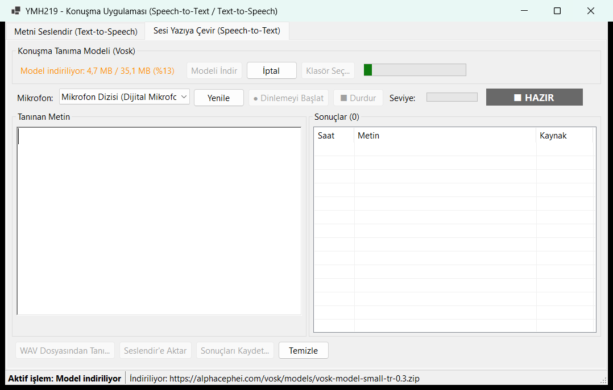
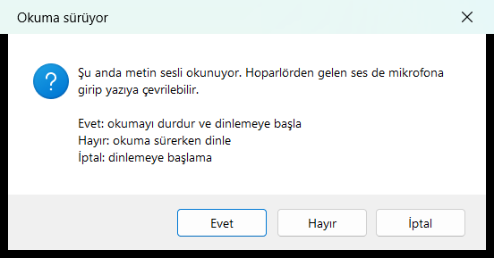

# YMH219 - Konuşma Uygulaması (Speech-to-Text / Text-to-Speech)

Nesne Tabanlı Programlama (YMH 219) dersi için C# ve Windows Forms ile yazılmış uygulama. Yazılan metin seslendirilir; mikrofon veya WAV dosyasındaki konuşma internet olmadan yazıya çevrilir.

## Özellikler

**Metni seslendir**
- Ses seçimi, oku / duraklat / durdur
- Okunan kelimeyi vurgulama, hız ayarı
- Metni `.txt` olarak açma / kaydetme

**Sesi yazıya çevir**
- Mikrofon listesi ve ses seviyesi
- Kısmi / kesin sonuçlar, zaman damgalı liste
- WAV dosyasından tanıma
- Türkçe Vosk modelini indirme veya klasör seçme
- Sonuçları seslendirme sekmesine aktarma

## Kullanılan teknolojiler

- C# / .NET 9, Windows Forms
- Windows.Media.SpeechSynthesis / MediaPlayer
- Vosk 0.3.38
- NAudio 3.3.0

## Çalıştırma

```bash
git clone https://github.com/kubradmrgc/YMH219-SpeechApp.git
cd YMH219-SpeechApp
dotnet run --project SpeechApp
```

İlk kullanımda "Sesi Yazıya Çevir" sekmesinden Türkçe modeli indirin (~35 MB). Mikrofon izni kapalıysa Windows Ayarlar > Gizlilik > Mikrofon bölümünü kontrol edin.

## Ekran görüntüleri






## Sınırlamalar

- Küçük Vosk modeli gürültülü ortamda ve özel isimlerde zayıf kalabilir.
- Yalnızca 64 bit Windows; WAV dışındaki ses biçimleri desteklenmez.
- Türkçe ses yoksa Windows’taki başka bir sesle okunur.

## Öğrenci

- Ad Soyad: Kübra Demirgüç
- Öğrenci No: 230541115
